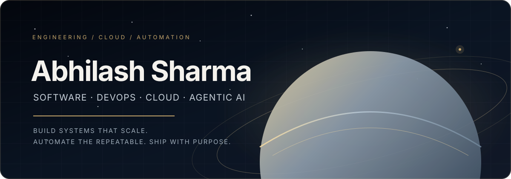
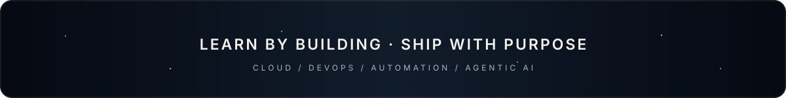

<!-- AURORA GLASS PROFILE — works on GitHub light & dark themes -->
<div align="center">



<a href="https://github.com/ABHILASH9519">

</a>

<br/>


<br/>

<a href="https://abhilash9519.github.io/Portfolio/"></a>
<a href="mailto:Abhilashsharma783@gmail.com"></a>
<a href="https://www.linkedin.com/in/abhilash-sharma-a72781290/"></a>
<a href="https://dev.to/abhilash_sharma_ed042f65e"></a>

</div>

<br/>


## ⟡ 01 / WHOAMI

<table>
<tr>
<td width="100%">

I started in **Full-Stack Development**, then found my real passion in **Cloud Engineering, DevOps, Infrastructure Automation and scalable systems**. Today I design, automate and ship reliable, production-oriented solutions, increasingly powered by **Generative AI and Agentic workflows**.


</td>
</tr>
</table>

## ⟡ 02 / WHAT I'M BUILDING

<table>
<tr>
<td width="50%" valign="top">

### ☁️ [CloudSentinels](https://github.com/ABHILASH9519/cloudsentinels)
Exploring cloud incident handling, event-driven automation and operational visibility with AWS. The remediation workflow is being developed incrementally; live cluster remediation is not yet enabled.

</td>
<td width="50%" valign="top">

### 🌙 [LunarReg Workbench](https://github.com/ABHILASH9519/lunarreg-workbench)
A computer-vision project for registering and comparing lunar images from different missions and imaging conditions.

</td>
</tr>
<tr>
<td width="50%" valign="top">

### 📱 [Sahaara](https://github.com/ABHILASH9519/sahaara)
A mobile-app project focused on turning a product idea into usable Android and iOS flows.

</td>
<td width="50%" valign="top">

### 🔁 [CI/CD Automator](https://github.com/ABHILASH9519/CI-CD-Automator)
Experiments with automating build and delivery workflows.

</td>
</tr>
</table>

> 💡 I'm especially interested in making these projects useful to someone other than me: clear setup steps, reproducible tests, sensible issues, and documentation that matches the actual code.

## ⟡ 03 / SKILL RADAR

```text
 ☁️  Cloud & DevOps     ▰▰▰▰▰▰▰▰▰▱  90%
 🛠️  Tools              ▰▰▰▰▰▰▰▰▱▱  85%
 ⚙️  Automation         ▰▰▰▰▰▰▰▰▱▱  85%
 🧩  Backend Dev        ▰▰▰▰▰▰▰▰▱▱  80%
 🤖  AI & ML            ▰▰▰▰▰▰▰▱▱▱  78%
 🔐  Cybersecurity      ▰▰▰▰▰▰▱▱▱▱  60%
 🌐  Web3               ▰▰▰▰▰▱▱▱▱▱  55%
```

## ⟡ 04 / TECHNICAL STACK

<details open>
<summary><b>💻 Programming Languages</b></summary>
<br/>

</details>

</details>

<details open>
<summary><b>☁️ Cloud, DevOps & Platforms</b></summary>
<br/>

</details>

<details open>
<summary><b>🤖 AI, ML & Agentic AI</b></summary>
<br/>


<br/>
<sub>LLM applications · RAG pipelines · tool-using agents · MCP integrations · evaluation and deployment</sub>
</details>

</details>

<details open>
<summary><b>🗄️ Databases & Messaging</b></summary>
<br/>

</details>

<details open>
<summary><b>🌐 Backend, Frameworks & Web</b></summary>
<br/>

</details>

</details>

<details open>
<summary><b>🧪 Version Control, Build & Testing</b></summary>
<br/>

</details>

<details open>
<summary><b>📈 Monitoring, IaC & Automation</b></summary>
<br/>


</details>

<details open>
<summary><b>🖥️ Operating Systems & Virtualization</b></summary>
<br/>

</details>

<details open>
<summary><b>🧰 Development Tools</b></summary>
<br/>
<a href="https://www.jetbrains.com/go/"></a>
<a href="https://www.jetbrains.com/idea/"></a>
<a href="https://www.jetbrains.com/webstorm/"></a>


</details>

</details>

<details open>
<summary><b>🤝 Collaboration & Project Management</b></summary>
<br/>


</details>

## ⟡ 05 / GITHUB ANALYTICS

<div align="center">


<table>
<tr>
<td width="50%"></td>
<td width="50%"></td>
</tr>
</table>

<a href="https://github.com/ABHILASH9519?tab=overview"></a>
<a href="https://github.com/pulls?q=is%3Apr+reviewed-by%3AABHILASH9519"></a>
<a href="https://github.com/ABHILASH9519?tab=issues"></a>
<a href="https://github.com/pulls?q=is%3Apr+author%3AABHILASH9519"></a>

</div>

## ⟡ 06 / CONTRIBUTION STREAK

<div align="center">

</div>

## ⟡ 07 / CONNECT

<div align="center">

<a href="https://github.com/ABHILASH9519"></a>
<a href="https://www.linkedin.com/in/abhilash-sharma-a72781290/"></a>
<a href="mailto:Abhilashsharma783@gmail.com"></a>
<a href="https://dev.to/abhilash_sharma_ed042f65e"></a>
<a href="https://abhilash9519.github.io/Portfolio/"></a>

</div>


