<!-- MONO STEEL PROFILE — FULL TECHNOLOGY ICON CATALOG -->

---

## 01 / WHOAMI

I started in **Full-Stack Development**, then found my real passion in **Cloud Engineering, DevOps, Infrastructure Automation and scalable systems**. Today I design, automate and ship reliable, production-oriented solutions, increasingly powered by **Generative AI and Agentic workflows**.

## 02 / WHAT I'M BUILDING

| Project | What it is |
|---|---|
| [CloudSentinels](https://github.com/ABHILASH9519/cloudsentinels) | Exploring cloud incident handling, event-driven automation and operational visibility with AWS. The remediation workflow is being developed incrementally; live cluster remediation is not yet enabled. |
| [LunarReg Workbench](https://github.com/ABHILASH9519/lunarreg-workbench) | A computer-vision project for registering and comparing lunar images from different missions and imaging conditions. |
| [Sahaara](https://github.com/ABHILASH9519/sahaara) | A mobile-app project focused on turning a product idea into usable Android and iOS flows. |
| [CI/CD Automator](https://github.com/ABHILASH9519/CI-CD-Automator) | Experiments with automating build and delivery workflows. |

I'm especially interested in making these projects useful to someone other than me: clear setup steps, reproducible tests, sensible issues, and documentation that matches the actual code.

## 03 / SKILL RADAR

## 04 / TECHNICAL STACK

### 01 — Programming Languages

### 02 — Cloud, DevOps & Platforms

### 03 — AI, ML & Agentic AI

LLM applications · RAG pipelines · tool-using agents · MCP integrations · evaluation and deployment

### 04 — Databases & Messaging

### 05 — Backend, Frameworks & Web Development

### 06 — Version Control, Build & Testing

### 07 — Monitoring, Infrastructure as Code & Automation

### 08 — Operating Systems & Virtualization

### 09 — Development Tools & Platforms

### 10 — Collaboration & Project Management

## 05 / GITHUB ANALYTICS

<table>
<tr>
<td width="50%"></td>
<td width="50%"></td>
</tr>
</table>
<table>
<tr>
<td width="25%" align="center"><b>COMMITS</b> </td>
<td width="25%" align="center"><b>CODE REVIEWS</b> </td>
<td width="25%" align="center"><b>ISSUES</b> </td>
<td width="25%" align="center"><b>PULL REQUESTS</b> </td>
</tr>
</table>

## 06 / CONTRIBUTION STREAK

## 07 / CONNECT

  
  
  
  
  

---

Mono Steel-inspired profile · Learn by building · Solve real problems · Ship with purpose.
