

 

I started with **Full-Stack Development** and grew into **Cloud Engineering, DevOps, Infrastructure Automation and scalable systems**. I enjoy building reliable software, streamlining delivery workflows, and exploring how **Generative AI and Agentic systems** can solve practical engineering problems.

 

 


 












 


 

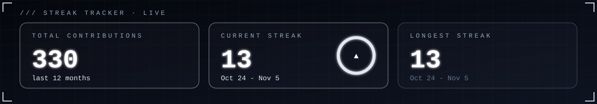

 


 


&nbsp;&nbsp;
&nbsp;&nbsp;
&nbsp;&nbsp;

  

