 

I started in **Full-Stack Development**, then found my real passion in **Cloud Engineering, DevOps, Infrastructure Automation and scalable systems**. Today I design, automate and ship reliable, production-oriented solutions, increasingly powered by **Generative AI and Agentic workflows**.

 

 

 

  

  

  
  
  
  
  
  
  

  

  
  
  
  
  
  
  
  
  

  

  

  

  

  
  
  
  

  
  
  

  &nbsp;
  &nbsp;
  &nbsp;
  &nbsp;
  &nbsp;
  &nbsp;
  &nbsp;
  &nbsp;
  &nbsp;
  &nbsp;
  &nbsp;
  &nbsp;
  &nbsp;
  &nbsp;
  &nbsp;
  &nbsp;
  

  
  

  
  
  

 

   

 

 

 

 

 

&nbsp;&nbsp;
&nbsp;&nbsp;
&nbsp;&nbsp;

  

